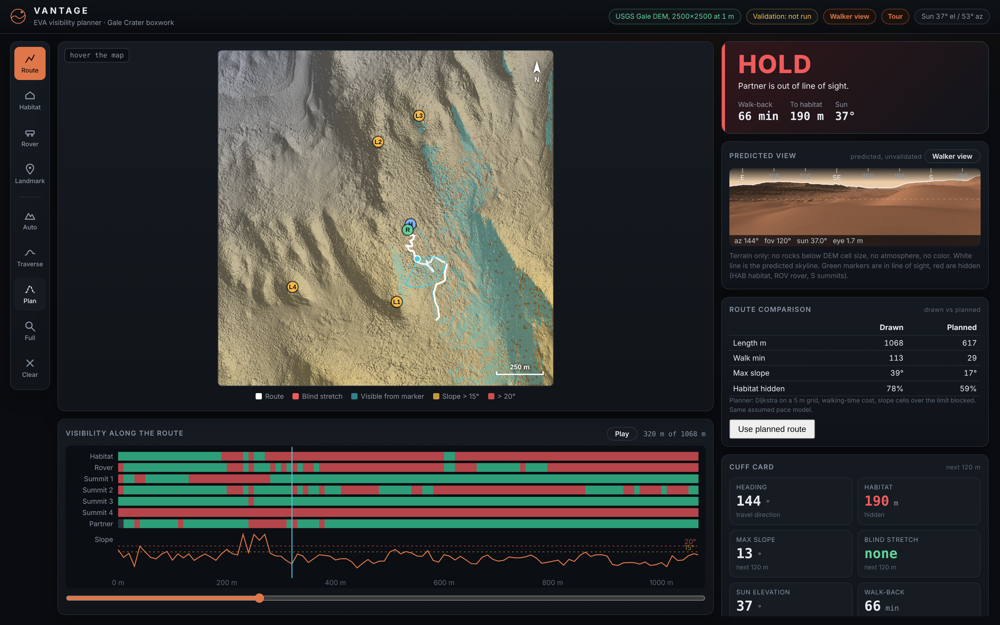

# Vantage

**Terrain-based visibility planning for Mars EVA. For any route, it predicts what a walking astronaut can see, and what they will lose sight of: habitat, rover, partner, landmarks.**

NASA Space Apps Challenge 2026, *Interplanetary Survival Guide: Martian Map*. Site: Gale Crater, Mount Sharp boxwork region (Curiosity rover traverse).



[Live demo](#live-demo) &middot; [Methodology](docs/METHODOLOGY.md) &middot; [Architecture](docs/ARCHITECTURE.md) &middot; [Data](docs/DATA.md) &middot; [Validation](docs/VALIDATION.md) &middot; [Limitations](docs/LIMITATIONS.md) &middot; [References](docs/REFERENCES.md)

---

## The problem

- On foot, navigation depends on seeing landmarks. Terrain decides whether you can.
- Apollo crews misjudged distance and slope, the Apollo 14 crew did not recognize the rim of Cone Crater, and low sun made slopes look steeper than they were.
- On Mars, ground control is up to about 20 minutes away by radio, so the crew and the pre-planned route carry more of the safety burden.
- Traverse planning weighs slope, distance and time, and Artemis planning already uses line of sight to the lander as one input. We did not find a tool that shows, along a whole route, which landmarks, partner and vehicles stay in view, renders what the crew would see, and flags where that view is likely to mislead them.

## What Vantage does

All outputs are computed from a digital elevation model (DEM) and the traverse geometry:

| Output | Question it answers |
|---|---|
| **Verdict** | CLEAR, CAUTION or HOLD at the current point on the route, with the reason and the walk-back time. |
| **Visibility strip** | Along this route, where are habitat, rover, partner and landmarks in view, and where is nothing in view? |
| **Predicted view** | What does the skyline and terrain look like from this point, looking this way, at this local solar time? A full-screen **Walker view** follows the route with the arrow keys. |
| **Safety checks** | Slope against the planning limit, ground hidden ahead, low sun, terrain shadow, partner out of sight, how sensitive habitat visibility is to a position error, and a walk-back time checked against a shelter limit when a solar particle event alert is set. |
| **Route planner** | A slope-limited route that prefers keeping the habitat in view, compared with the drawn route on length, time, steepest slope and share of the route with the habitat hidden. |

The **cuff card** gives the numbers a crew member would need on a wrist display: heading, habitat distance and visibility, max slope ahead, next blind stretch, sun elevation, walk-back time and total walk time. A 60 second guided tour in the app shows each feature on the real route.

## Scientific goal and location

- **Goal:** support safe, navigable EVA in terrain where the landmarks you rely on can disappear behind low relief.
- **Site:** Gale Crater boxwork on Mount Sharp. Networks of low ridges (about 1 to 2 m tall) with sandy hollows between them, which is the kind of terrain that hides things from a person at eye height. Curiosity has driven it, so real rover imagery exists to test against.
- **Time window used for tests:** Curiosity sols around 4600 onward (boxwork campaign).

## How it meets the challenge brief

| Requirement | How |
|---|---|
| At least 3 kinds of data, layered | Orbital topography (USGS Gale 1 m DEM), rover traverse (NASA MMGIS waypoints), solar geometry (Ls, local true solar time), derived slope. Surface imagery from Curiosity is used for validation. |
| Astronaut safety first | Visibility and blind-stretch warnings, hidden-ground-ahead flag, low-sun flag, terrain shadow, slope limits, partner line of sight, and a walk-back time checked against a user-set shelter limit during a solar particle event alert. A radiation model and dust are out of scope and listed under [limitations](docs/LIMITATIONS.md). |
| Suited mobility and obstacle avoidance | Slope-derated walking time. A planner finds a route that avoids slopes over a set limit and keeps the habitat in view, and the drawn route is checked against slope and visibility. Obstacles smaller than the DEM cell are not modeled. |
| Point-of-view surface imagery | Predicted first-person terrain view. Compared with real Curiosity panoramas in [validation](docs/VALIDATION.md). |
| Rovers, robots, crew pairs | Rover is a visibility target. A trailing partner at a set distance gives a lost-partner flag. |
| Format | Browser app. Cuff card is designed for a wrist or tablet display. Nothing is mounted to the helmet. |

## Live demo

- GitHub Pages: see the repository's *About* link. Choose *Take the 60 second tour* on the welcome card.
- Local: see below.

## Run locally

Requires Python 3.10+ and Node 20+.

```bash
# 1. Fetch a 2.5 km window of the real USGS Gale DEM (about 150 MB transferred, reads only the window)
pip install -r pipeline/requirements.txt
python pipeline/fetch_terrain_window.py

# 2. Serve the app
cd web && python -m http.server 8000     # open http://localhost:8000

# 3. Tests
node --test tests/core.test.mjs          # visibility core
python tests/test_pipeline.py            # data pipeline on a synthetic GeoTIFF
```

If `web/data/` does not contain `dem.f32`, the app falls back to synthetic terrain and shows a red banner. Synthetic terrain is only for development and is never presented as Mars.

## Repository layout

```
web/            Static app (no build step): UI, visibility core, terrain loader, data
  js/           terrain.js, visibility.js, sun.js, app.js
  data/         Processed terrain window and traverse used by the app
pipeline/       Windowed read of the USGS DEM and MMGIS waypoints
tests/          Unit tests (JS core) and pipeline test (Python)
docs/           Methodology, architecture, data, validation, limitations, references
.github/        CI and GitHub Pages deployment
```

## Status

- Working: visibility core, route products, predicted view and Walker view, verdict, walk-back and shelter check, terrain shadow, position-sensitivity check, route planner, guided tour, data pipeline, 22 JS tests and a pipeline test.
- Validation against real Curiosity panoramas: see [docs/VALIDATION.md](docs/VALIDATION.md) for protocol and current results.
- Every threshold and height in the app is an editable assumption with its basis stated in [docs/METHODOLOGY.md](docs/METHODOLOGY.md#assumption-register). None is a measured Mars value unless stated.

## License and credits

- Code: MIT (see `LICENSE`).
- Data: NASA and USGS products, used under their public terms. See [docs/DATA.md](docs/DATA.md).
- Author: Rashi Tyagi.
