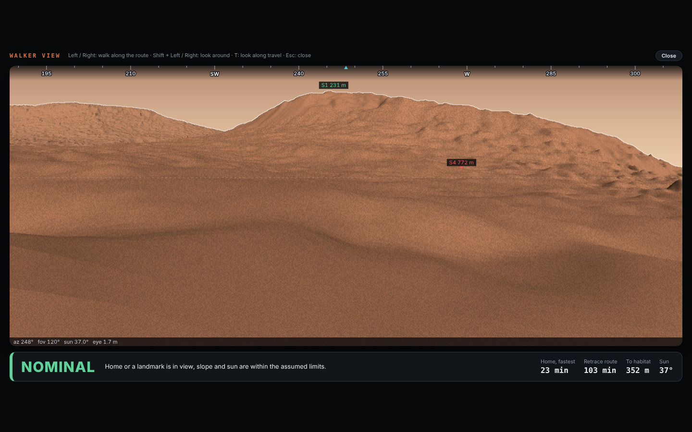
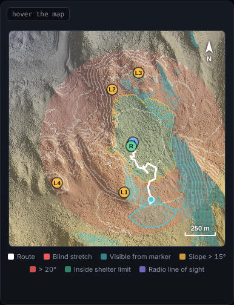
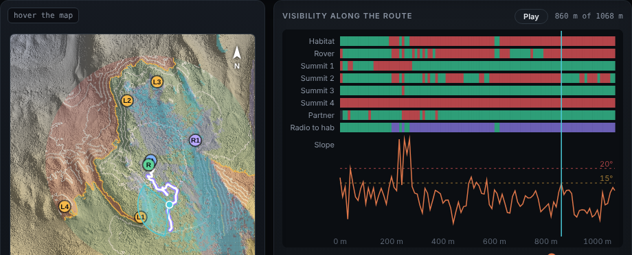
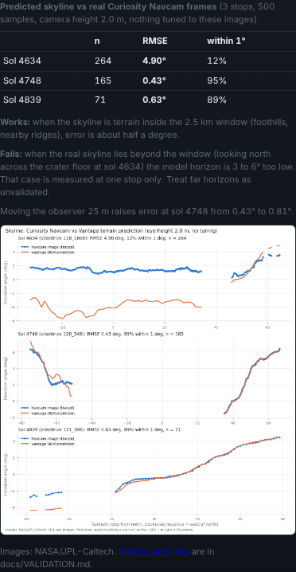

<div align="center">

<picture>
  <source media="(prefers-color-scheme: light)" srcset="docs/img/vantage-wordmark-light.svg">
  
</picture>

<br>

### See what a walking astronaut can see, before they walk.
Predicts the view along a Mars EVA route on 1 m NASA terrain, flags where home drops out of sight,<br>and shows the fastest way back, the radio gaps and how much time is left.

<br>

[**Live demo**](#live-demo) &nbsp;&middot;&nbsp; [**60 second tour**](#live-demo) &nbsp;&middot;&nbsp; [Methodology](docs/METHODOLOGY.md) &nbsp;&middot;&nbsp; [Validation](docs/VALIDATION.md) &nbsp;&middot;&nbsp; [Limitations](docs/LIMITATIONS.md) &nbsp;&middot;&nbsp; [Data](docs/DATA.md)

<br>


<br>


</div>

<br>

## Why

On foot, navigation depends on seeing landmarks, and terrain decides whether you can. Apollo crews misjudged distance and slope, the Apollo 14 crew did not recognize the rim of Cone Crater, and low sun made slopes look steeper than they were. On Mars the crew is also up to about 20 minutes from ground control by radio, so the route itself carries more of the safety burden.

Traverse planning already weighs slope, distance and time, and Artemis planning uses line of sight to the lander as one input. We did not find a tool that shows, along a whole route, what stays in view, renders what the crew would see, and flags where that view is likely to mislead them.

<br>

## What it tells you on the real Curiosity route

<table>
<tr>
<td width="33%" align="center"><h3>77%</h3>of the route has no radio line of sight to the habitat. One relay at the marked site would cover all of it.</td>
<td width="33%" align="center"><h3>29 min vs 113 min</h3>fastest way home from the far end of the route, against retracing the drawn route.</td>
<td width="33%" align="center"><h3>0.4 to 0.6&deg;</h3>skyline error against real Curiosity camera frames where the horizon is inside the terrain window.</td>
</tr>
</table>

Numbers are computed live from the loaded route and terrain. They are predictions with labeled assumptions, not measurements.

<br>

## Features

<table>
<tr>
<td width="50%" valign="top">



**Walker view**<br>
Full-screen predicted view from eye height, with compass, sun, distance labels and the verdict underneath. Arrow keys walk the route.

</td>
<td width="50%" valign="top">



**Shelter reach**<br>
The fastest walking time home as contours every 15 minutes that bend around steep ground, with the shelter limit marked, against retracing the drawn route.

</td>
</tr>
<tr>
<td width="50%" valign="top">



**Radio shadow and relay siting**<br>
Where terrain cuts line of sight to the habitat, the longest outage in minutes of walking, and the best relay sites. Geometry only, not a link budget.

</td>
<td width="50%" valign="top">



**Checked against real images**<br>
Predicted skyline against Curiosity Navcam frames at three stops. The page reports the failure toward the far horizon as plainly as the good match.

</td>
</tr>
</table>

| | |
|---|---|
| **Verdict** | NOMINAL, CAUTION or HOLD at the current point, with the reason, the fastest way home and the retrace time. Advisory only, not a safety certification. |
| **Start back within** | The smallest margin among the shelter limit (during a solar particle event alert), daylight (Sun below 5 degrees or terrain shadow) and suit time, after subtracting the fastest way home. |
| **Visibility strip** | Where habitat, rover, partner, landmarks and radio are in view along the whole route, and where nothing is. |
| **Safety checks** | Slope against the planning limit, ground hidden ahead, low sun, terrain shadow, partner out of sight, and how sensitive habitat visibility is to a position error. |
| **Route planner** | A slope-limited route that keeps the habitat in view, compared with the drawn route on length, time, steepest slope and share of route with the habitat hidden. |
| **Cuff card** | The numbers a crew member needs on a wrist or tablet display: heading, habitat distance, max slope ahead, next blind stretch, sun, time home, radio gap. |

<br>

## Live demo

- Open the site from this repository's *About* link and choose **Take the 60 second tour** on the welcome card.
- Or run it locally, below. The app is static HTML, CSS and JavaScript.

<br>

## How it meets the challenge brief

| Requirement | How |
|---|---|
| At least 3 kinds of data, layered | Orbital topography (USGS Gale 1 m DEM), rover traverse (NASA MMGIS waypoints), solar geometry (Ls and local true solar time), derived slope. Curiosity surface imagery is used for validation. |
| Astronaut safety first | Blind-stretch, hidden-ground, low-sun, terrain-shadow, slope, partner and radio checks, a shelter-reach map and start-back clocks against a user-set shelter limit. A radiation model and dust are out of scope, see [limitations](docs/LIMITATIONS.md). |
| Suited mobility and obstacle avoidance | Slope-derated walking time. A planner avoids slopes over a set limit and keeps the habitat in view. Obstacles smaller than the DEM cell are not modeled. |
| Point-of-view surface imagery | Predicted first-person terrain view, compared with real Curiosity Navcam frames in [validation](docs/VALIDATION.md). |
| Rovers, robots, crew pairs | The rover is a visibility target. A trailing partner at a set distance gives a lost-partner flag. |
| Format | Browser app. The cuff card suits a wrist or tablet display. Nothing is mounted to the helmet. |

<br>

## Validation in one table

3 stops, 7 Curiosity Navcam frames, 500 skyline samples, nothing tuned to them.

| Stop | Skyline RMSE | Within 1&deg; | What the skyline is |
|---|---|---|---|
| Sol 4748 | **0.43&deg;** | 95% | Foothills and ridges inside the 2.5 km terrain window |
| Sol 4839 | **0.63&deg;** | 89% | Foothills and ridges inside the 2.5 km terrain window |
| Sol 4634 | **4.90&deg;** | 12% | Far crater rim, outside the window. The model horizon is 3 to 6&deg; too low |

A 25 m position error raises the skyline error at sol 4748 from 0.43&deg; to 0.81&deg;. Seven frames at three stops is a small sample, and landmark visibility was not tested directly. Full method, exclusions and links: [docs/VALIDATION.md](docs/VALIDATION.md).

<br>

## Run locally

Requires Python 3.10+ and Node 20+.

```bash
# 1. Fetch a 2.5 km window of the real USGS Gale DEM (reads only the window)
pip install -r pipeline/requirements.txt
python pipeline/fetch_terrain_window.py

# 2. Serve the app
cd web && python -m http.server 8000     # open http://localhost:8000

# 3. Tests
node --test tests/core.test.mjs          # visibility, planner, shelter reach, radio (26 tests)
python tests/test_pipeline.py            # data pipeline on a synthetic GeoTIFF
node validation/validate.mjs             # rerun the skyline validation
```

If `web/data/dem.f32` is missing, the app falls back to synthetic terrain and shows a red banner. Synthetic terrain is only for development and is never presented as Mars.

<br>

## Repository layout

```
web/            Static app, no build step
  js/           terrain.js, visibility.js, sun.js, app.js
  data/         Processed terrain window, traverse and validation results
pipeline/       Windowed read of the USGS DEM and MMGIS waypoints
validation/     Skyline comparison against Curiosity Navcam frames
tests/          JS core tests and a Python pipeline test
docs/           Methodology, architecture, data, validation, limitations, references
.github/        CI and GitHub Pages deployment
```

<br>

## Limits worth knowing

- Every threshold and height is an editable assumption with its basis in the [assumption register](docs/METHODOLOGY.md#assumption-register). Walking pace and slope limits are lunar planning figures, not Mars measurements.
- The terrain window is 2.5 km. Horizons beyond it are not modeled and the predicted skyline there is too low.
- The shelter check is a time clock, not a radiation model. Radio shadow is geometric line of sight, not a link budget.
- Full list: [docs/LIMITATIONS.md](docs/LIMITATIONS.md).

<br>

## License and credits

- Code: MIT, see `LICENSE`.
- Data: NASA and USGS products used under their public terms, see [docs/DATA.md](docs/DATA.md). Curiosity images are NASA/JPL-Caltech.
- Built by Rashi Tyagi for the NASA Space Apps Challenge 2026, *Interplanetary Survival Guide: Martian Map*.
