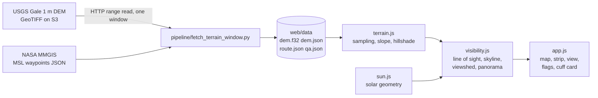

# Architecture

Sightline is a data pipeline plus a static browser app. There is no server and no build step.

## Components

| Path | Role |
|---|---|
| `pipeline/fetch_terrain_window.py` | Reads only the needed window of the 3.6 GB DEM using HTTP range requests (GDAL virtual file system). Converts Curiosity waypoints to window-local metres. Writes the four data files and a QA summary. |
| `web/js/terrain.js` | Loads the grid. Bilinear sampling, slope, hillshade. Also holds a synthetic terrain generator used only for development, always labeled. |
| `web/js/visibility.js` | Pure functions, no DOM: line of sight, route sampling, route visibility, blind runs, skyline, hidden-ground cone, viewshed, panorama render, walking time. |
| `web/js/sun.js` | Sun elevation and azimuth from latitude, solar longitude and local true solar time. |
| `web/js/app.js` | UI: map, tools, strip, panorama, flags, cuff card, provenance panel. |

Keeping `visibility.js` free of DOM code lets it be unit tested in Node and reused in other front ends.

## Data formats

- `dem.f32`: float32, little-endian, row-major, north row first, NaN for no-data. Size must equal `width * height * 4` bytes; the loader checks this.
- `dem.json`: grid dimensions, cell size, min/max, window centre, source product and its stated control accuracy, retrieval time, `synthetic` flag.
- `route.json`: waypoints with sol, longitude/latitude, window-local `x_m, y_m`, and an `inside` flag.

## Design decisions

- **Static app.** Reviewers can open it with any web server, and GitHub Pages hosts it for free.
- **Windowed read of a large GeoTIFF.** The product is 3.6 GB. Range requests fetch about 150 MB for a 2.5 km window. The file's index is at the end, which GDAL handles.
- **Honest fallback.** If real data is missing, the app shows synthetic terrain with a persistent warning rather than failing silently.
- **Assumptions in the UI.** Heights and thresholds are inputs, so a user can test how sensitive a conclusion is.

## Performance

- Line of sight is O(distance / step). Viewshed uses a coarse stride (about 150 by 150 cells) and a 1.5 km range so it stays interactive. It is recomputed after a short pause when the marker moves.
- Panorama rendering is one ray per image column (960 columns).

## Testing

- `tests/core.test.mjs`: 15 tests covering line of sight (flat, wall, low ridge), curvature, azimuth, sun geometry, route resampling, skyline, hidden ground, blind stretches, panorama-versus-skyline agreement, walking time, slope baseline smoothing and landmark suggestion. When the real terrain window is present, one test also checks the real grid, that suggested landmarks fall on valid data, and that the traverse has visible landmarks.
- `tests/test_pipeline.py`: builds a synthetic GeoTIFF with the same layout as the USGS product, runs the pipeline on it, and checks outputs and the `synthetic` flag.
- CI runs both on every push. The demo deploys from `web/` with GitHub Pages.
