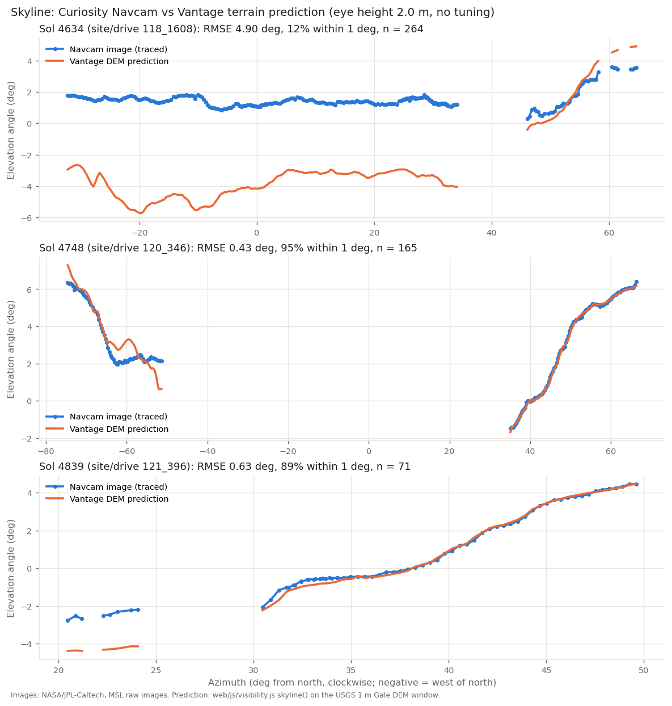

# Validation

Validation answers one question: **does the terrain-only predicted view match what a real Mars surface camera saw from the same place?**

## Hypotheses

- **H1.** At a known rover position, the predicted skyline elevation profile agrees with the skyline extracted from a real panorama to within a small angular error.
- **H2.** Landmarks the model calls visible are visible in the real panorama, and landmarks it calls hidden are hidden.
- **H3.** Prediction quality degrades gracefully with horizontal position error. We report how fast.

## Protocol

1. Choose 3 Curiosity stops in the boxwork campaign with a wide Mastcam or Navcam panorama and a known rover position (MMGIS waypoint).
2. For each stop, set the observer at the rover position, eye height at camera mast height (about 2.0 m), and compute the predicted skyline for the panorama's azimuth range.
3. Extract the real skyline from the panorama (terrain/sky boundary) and convert pixel rows to elevation angle using the camera model and rover attitude.
4. Compare landmarks that are identifiable in both the DEM and the image.
5. Repeat the prediction with the observer shifted by 0, 5, 10 and 25 m in each horizontal direction to measure sensitivity to registration error.

## Metrics

| Metric | Definition |
|---|---|
| Skyline RMSE | Root-mean-square difference, in degrees of elevation angle, between predicted and real skyline over the sampled image columns. |
| Within 1 and 2 degrees | Fraction of sampled columns where the absolute error is under 1 or 2 degrees. |
| Skyline peak precision and recall | Used in place of the full landmark test (see below). A peak is a local maximum within +/-2 deg azimuth that rises at least 0.5 deg above the lowest point within +/-4 deg. Predicted and image peaks match if they are within 1.5 deg azimuth. |
| Sensitivity | Skyline RMSE with the observer moved 5, 10 and 25 m in 8 directions. |

## What was done

**Images.** Curiosity Left Navcam (NAV_LEFT_B) full-frame images from the MSL raw image archive. Each image record carries a CAHVOR camera model in the rover frame and the rover attitude quaternion, so every pixel maps to an azimuth and elevation without manual pointing estimates. Mastcam was not used.

**Stop selection (fixed before any comparison).** The campaign (sols 4605 to 4857) was split into three equal sol ranges. In each, we took the drive whose post-drive Navcam frames had the highest mean mast elevation, because those frames show the most sky. This gave sols 4634, 4748 and 4839.

**Rover position.** The `route.json` waypoint with the same site/drive as the image (the image ID encodes it, for example `F1181608` is site 118, drive 1608). Check: the heading from each image's attitude quaternion matches the waypoint yaw to within 0.01 deg at all three stops. The DEM elevation at each waypoint is within 0.25 m of the MMGIS value, but both come from the same DEM family, so this confirms georeferencing only.

**Camera height.** The camera model puts the Navcam 1.91 to 1.93 m above the rover frame origin. We used 2.0 m as planned, and report results for 1.5 and 2.5 m below.

**Prediction.** `skyline()` from `web/js/visibility.js`, unchanged, on `web/data/dem.f32`, at 0.1 deg azimuth steps, interpolated to each image sample. No model parameter was changed or fitted to these images.

**Skyline tracing.** In each frame we marked the column ranges where sky is visible above the terrain by looking at the image. Within those ranges, the boundary row was found automatically (a top-down brightness-drop tracer, or a path tracer on the vertical brightness gradient, chosen per range by which one sat on the boundary in the overlay). Rows were sampled every 8 px (about 0.36 deg). Automatic cleaning drops samples that touch the frame top, isolated jumps, and the path tracer's vertical ramps between edges. We then audited every traced segment over its image and excluded five column ranges where the trace was not on the sky boundary. These exclusions are listed with reasons in `validation/validate.mjs` and `results.json`, and were based on the image alone.

**Frames not used.** 10 of the 17 near-horizontal frames at these drives show no sky (terrain fills the top of the frame, mostly looking up Mount Sharp). Three frames at sol 4748 that look north were excluded because dust haze hides the far skyline and distant terrain shows above the nearer edges.

## Results

| Stop | Sol | Site/drive | Azimuth covered (deg) | Samples | Skyline RMSE (deg) | Bias (deg) | Within 1 deg | Within 2 deg | Peak precision | Peak recall |
|---|---|---|---|---|---|---|---|---|---|---|
| 1 | 4634 | 118_1608 | 328 to 65 | 264 | **4.90** | -4.43 | 12% | 15% | 0.25 (1 of 4) | 0.33 (1 of 3) |
| 2 | 4748 | 120_346 | 285 to 309, 35 to 66 | 165 | **0.43** | +0.05 | 95% | 100% | 0.50 (1 of 2) | 1.00 (1 of 1) |
| 3 | 4839 | 121_396 | 20 to 50 | 71 | **0.63** | -0.28 | 89% | 100% | no peaks | no peaks |
| All | | | | 500 | 3.58 | -2.36 | 50% | 55% | | |

Bias is predicted minus real; negative means the model horizon is too low. Before the overlay audit (automatic cleaning only) the RMSE values were 4.83, 1.33 and 0.59 deg. At stop 2 the audit removed traces on the wrong edge, which had inflated the error. At stops 1 and 3 the audit made the result slightly worse.

### Position sensitivity (H3)

RMSE in degrees, mean over 8 shift directions (worst direction in brackets).

| Stop | 0 m | 5 m | 10 m | 25 m |
|---|---|---|---|---|
| 4634 | 4.90 | 4.81 (5.05) | 4.89 (5.13) | 5.07 (5.48) |
| 4748 | 0.43 | 0.46 (0.57) | 0.53 (0.72) | 0.81 (1.09) |
| 4839 | 0.63 | 0.62 (0.66) | 0.63 (0.68) | 0.74 (0.91) |

Eye height from 1.5 to 2.5 m changes RMSE by at most 0.3 deg at any stop.

### Findings

- **Where the skyline is terrain inside the DEM window, the prediction matches the camera.** At stops 2 and 3 the skyline is Mount Sharp foothills and nearby ridges, 0.1 to 1.2 km away. The error there is about half a degree, and 89 to 95% of samples are within 1 deg. H1 holds for these directions.
- **Where the real skyline is beyond the DEM window, the prediction is wrong by 3 to 6 deg.** At stop 1, looking north down the slope, the camera sees a skyline at +0.8 to +1.8 deg. All terrain inside the 2.5 km window in those directions sits below -2.6 deg, so the visible skyline must be terrain the window does not contain, consistent with the far side of Gale crater. The model cannot predict that skyline. Our "window-limited" flag (horizon point within 100 m of the window edge) does not catch this case, because the highest point inside the window is a nearer ridge.
- **This north-facing failure was measured at one stop only.** The north-facing frames at the other two stops were excluded for haze, so we cannot say how often it occurs. Treat the predicted skyline toward the crater floor as unvalidated and likely too low.
- **Landmarks (H2) were not tested as written.** We used skyline peaks as a proxy. At stop 2 the main predicted peak (az 55.8, el 5.22) matches the image peak (az 55.5, el 5.21). At stop 1 the single azimuth match pairs a near ridge at -3.3 deg with a far peak at +1.8 deg, so it is not a real landmark match. Peak counts are too small for the precision and recall values to mean much.
- **Position error up to 25 m roughly doubles the error at stop 2** (0.43 to 0.81 deg mean, 1.09 deg worst) and has a smaller effect at stop 3, where the skyline is farther away. At stop 1 the missing far terrain dominates.

## Follow-on: position from the real skyline (horizon fix)

Using the same traced skylines, the app searched a 1.2 x 1.2 km box for the position whose predicted skyline best matches each real frame, with no knowledge of the rover position.

| Stop | Result | Why |
|---|---|---|
| Sol 4748 | Within 5 m, unambiguous | Skyline is nearby foothills inside the window, 57 deg of azimuth |
| Sol 4634 | Fails | Real horizon is the far crater rim, outside the 2.5 km window |
| Sol 4839 | Fails | Only about 30 deg of skyline in the usable frame |

## Data and links

All images are credited NASA/JPL-Caltech. Image crops are not included in the repo. Links to each image are in `web/data/validation/results.json`.

| Sol | Image ID | Raw image page |
|---|---|---|
| 4634 | NLB_808884327EDR_F1181608NCAM00252M_ | https://mars.nasa.gov/raw_images/1503366 |
| 4634 | NLB_808884358EDR_F1181608NCAM00252M_ | https://mars.nasa.gov/raw_images/1503369 |
| 4634 | NLB_808884389EDR_F1181608NCAM00252M_ | https://mars.nasa.gov/raw_images/1503373 |
| 4748 | NLB_818994980EDR_F1200346NCAM00271M_ | https://mars.nasa.gov/raw_images/1539447 |
| 4748 | NLB_818995760EDR_F1200346NCAM00272M_ | https://mars.nasa.gov/raw_images/1539559 |
| 4839 | NLB_827077719EDR_F1210396NCAM00268M_ | https://mars.nasa.gov/raw_images/1566029 |
| 4839 | NLB_827077750EDR_F1210396NCAM00268M_ | https://mars.nasa.gov/raw_images/1566032 |

Reproduce: `node validation/validate.mjs` then `python3 validation/plot_skyline.py` from the repo root. See `validation/README.md`.

## Threats to validity

- Skyline tracing involved a human choice of which column ranges show sky. The choice and every exclusion are recorded, and were made from the images, but a different reader could draw some ranges differently.
- The same tracing was not repeated by an independent person.
- Seven frames at three stops is a small sample. Coverage is mostly toward Mount Sharp and to the east and west. The north-facing far horizon was measured at one stop.
- The DEM cell (1 m) limits what small relief can be matched. Rocks near the camera are not in a bare-earth DEM.
- Rover position is an estimate (wheel odometry corrected by visual and orbital localization). The waypoint and the DEM share a source, so their agreement does not test absolute position.
- Navcam JPEG compression and haze blur the boundary. Pixel-to-angle error from the camera model is small next to the errors reported here (a sample spacing of 8 px is about 0.36 deg).
